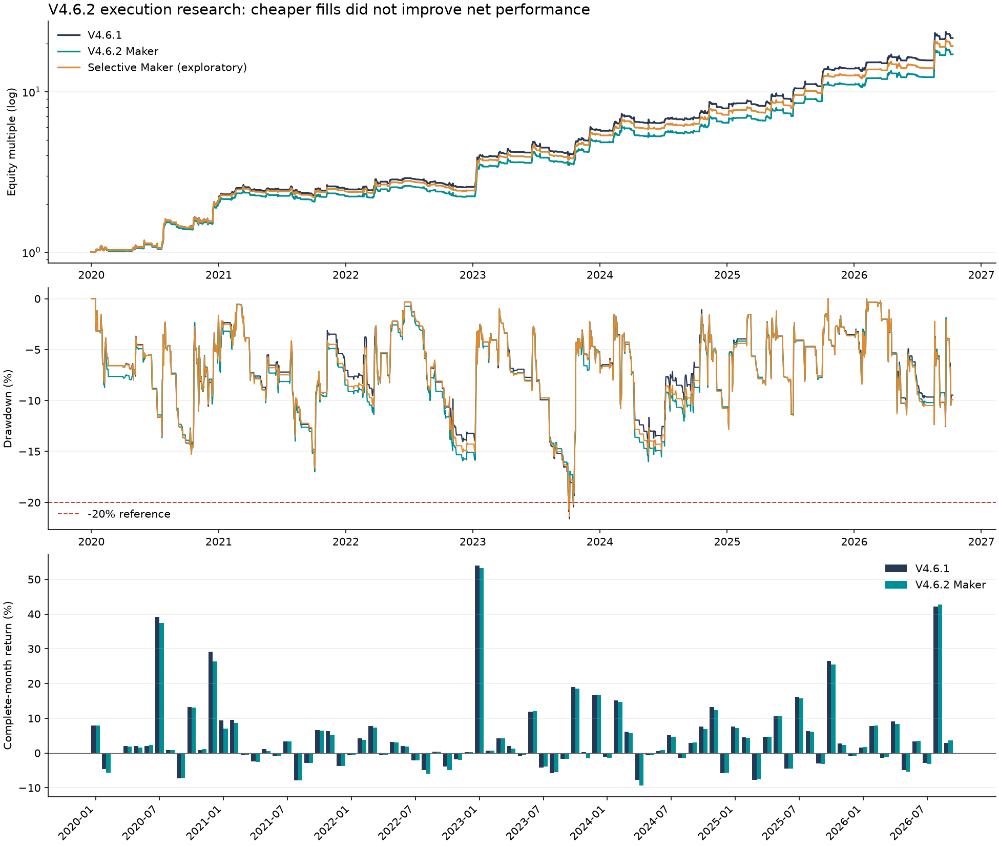

# V4.6.2：点位、Maker 与频率优化研究（未通过升级验收）

截至 2026-10-20。使用已有 Bitget BTCUSDT 5 分钟缓存：2020-01-01 00:00 至 2026-10-11 08:00 UTC。

**结论：没有找到同时提高收益、夏普、正收益月份比例且最大回撤约 20% 的可靠升级。保留 V4.6.1；V4.6.2 仅作为研究版本，不替换默认策略。**

先测试 8 个固定候选（含原版对照），锁定失败结果后完成压力测试；随后追加 1 个公开标记为“看过结果后提出”的执行假设。总计 9 个主方案、6 个压力情景（其中资金费为路径敏感性）、4 个邻域诊断。没有通过不断扩展网格寻找达标参数。

## 全样本对比

| 方案 | 年化收益 | 日收益夏普 | 最大回撤 | 平均月收益 | 月收益标准差 | 正收益月比例 | 完整交易/年 | Maker成交额占比 | 加权净费率bps |
|---|---|---|---|---|---|---|---|---|---|
| V4.6.1 | 57.41% | 1.713 | -21.62% | 4.43% | 10.79% | 61.73% | 75.254 | 0.00% | 2.400 |
| V4.6.2 Maker | 52.04% | 1.600 | -20.87% | 4.12% | 10.62% | 60.49% | 74.958 | 28.58% | 1.943 |
| Selective Maker (exploratory) | 54.75% | 1.659 | -21.37% | 4.29% | 10.81% | 60.49% | 75.106 | 8.90% | 2.258 |

原版正收益月份为 50/81，Maker 候选为 49/81；两者都有一个零收益月份。最差月原版 -7.85%，Maker -9.38%。最长连续亏损均为 3 个月。
Maker 占总成交额 28.58%，加权净费率下降 19.05%，但年化收益降低 5.37 个百分点，夏普下降 0.113。省费未覆盖等待成交的机会成本。手续费总额随账户增长和成交额一起变化，不能直接把两账户总费用差认作纯节省。

## 本轮实现

- V4.6.1 因子、0.90 暴露和多空规则作为控制。新增 V4.6.2 参数封装，支持调整多头突破长度、冷却、持有期、跟踪止损和回踩条件。
- Maker 买单固定在提交时开盘价下方 1 bps，卖单相反；挂单价格与目标数量不随下一根 K 线重新计算。至少等待一根 5 分钟 K 线，价格还需穿过限价 1 bps 才认定成交。
- Maker 最多占 K 线成交额的 0.5%（原有 2% 容量上限乘 25%）；允许部分成交。15 分钟未完成，剩余转 Taker。减仓、反向、保护性退出和期末平仓使用 Taker。
- 追加探索：首次建仓整条指令使用 Taker，仅已有同方向头寸的加仓使用 Maker。结果仍弱于原版，未采用。
- 修复无成交量时 Maker 超时回退被旧分支丢弃的边界问题；控制、Maker、追加探索的全段权益及成交逐项回归一致。

## 手续费与返佣

沿用项目费率假设：Maker 2 bps（0.02%）、Taker 6 bps（0.06%），返佣 60%，净费率分别 **0.8 bps / 2.4 bps（0.008% / 0.024%）**。所有成交都计成本；返佣按当次手续费直接抵扣，未模拟到账延迟。这是账户模型输入，不代表已核实当前账户等级或返佣合同。

## 固定候选：2020–2025 开发样本

| 候选 | 年化收益 | 日收益夏普 | 最大回撤 | 正收益月比例 | 完整交易数 | 通过全部条件 |
|---|---|---|---|---|---|---|
| control_taker | 55.15% | 1.747 | -21.62% | 61.11% | 445 | False |
| control_maker | 49.30% | 1.615 | -20.87% | 59.72% | 443 | False |
| risk85_maker | 46.38% | 1.618 | -19.81% | 59.72% | 443 | False |
| break4_risk85 | 46.55% | 1.622 | -19.12% | 59.72% | 446 | False |
| cooldown1_risk85 | 39.78% | 1.440 | -24.18% | 59.72% | 458 | False |
| hold48_risk85 | 34.93% | 1.321 | -20.46% | 55.56% | 523 | False |
| trail25_risk85 | 42.59% | 1.557 | -21.60% | 61.11% | 454 | False |
| reclaim_risk85 | 42.25% | 1.537 | -20.33% | 58.33% | 427 | False |

两个子段为 2020–2023 与 2024–2025，连续账户在边界切片；2025 年末开发回放有期末平仓，完整回放继续持仓，因此边界收益可能略有差别。选择要求两段盈利，开发 CAGR≥50%，日夏普与正月比例不低于原版，回撤≤22%，交易数为原版的 1–1.6 倍。22% 是本轮对“约 20%”的研究容差，**不是 20% 硬上限**。

全部候选至少一项不达标。按原规则锁定 control_maker 仅用于后续失败诊断，不是选出了获胜策略。
更短冷却把交易数由 445 提高至 458，但年化降至 39.78%、回撤扩大至 24.18%；48 小时持有上限把交易数提高至 523，但年化降至 34.93%。成交笔数因拆单增加也不等于新的独立信号增加。

## 分段与 2026 诊断

| 方案 | 区间 | 年化收益 | 日收益夏普 | 回撤 | 正月比例 |
|---|---|---|---|---|---|
| V4.6.1 | full | 57.41% | 1.713 | -21.62% | 61.73% |
| V4.6.1 | 2020_2023 | 55.08% | 1.746 | -21.62% | 60.42% |
| V4.6.1 | 2024_2025 | 55.30% | 1.749 | -14.40% | 62.50% |
| V4.6.1 | 2026_diagnostic | 76.06% | 1.625 | -12.55% | 66.67% |
| V4.6.2_candidate | full | 52.04% | 1.600 | -20.87% | 60.49% |
| V4.6.2_candidate | 2020_2023 | 48.88% | 1.607 | -20.87% | 58.33% |
| V4.6.2_candidate | 2024_2025 | 50.14% | 1.630 | -16.00% | 62.50% |
| V4.6.2_candidate | 2026_diagnostic | 75.05% | 1.610 | -11.99% | 66.67% |

2026 不是从未看过的留出数据：本项目此前已有研究使用这些历史。它仅为按时间顺序分段的诊断，不能证明真实样本外有效。追加的选择性 Maker 假设在看过上述结果后提出，也不得包装成预注册或盲测。

## 压力与邻域

| 场景 | 年化收益 | 日收益夏普 | 回撤 | 正月比例 |
|---|---|---|---|---|
| base | 52.04% | 1.600 | -20.87% | 60.49% |
| all_taker | 57.41% | 1.713 | -21.62% | 61.73% |
| maker_strict | 51.62% | 1.590 | -21.52% | 60.49% |
| no_rebate | 45.79% | 1.456 | -21.87% | 60.49% |
| double_slippage | 49.79% | 1.549 | -21.17% | 60.49% |
| extra_hour_latency | 47.25% | 1.504 | -22.25% | 56.79% |
| synthetic_adverse_1bp_per_8h_path_sensitivity | 48.74% | 1.527 | -21.38% | 60.49% |

资金费路径敏感性仅在真实资金费缺失阶段，对每个 8 小时结算点前实际头寸按绝对名义金额收取 1 bp，不区分多空。使用冻结成交路径和权益比例复合扣减，不重新模拟仓位反馈，**不是补齐的真实资金费，也不是完整微观回放**。其它压力情景均重新回放。取消返佣、滑点翻倍、增加一小时延迟时均不能稳健保持年化 50%。

| 邻域 | 年化收益 | 日收益夏普 | 回撤 | 正月比例 |
|---|---|---|---|---|
| exposure_minus005 | 48.92% | 1.602 | -19.81% | 60.49% |
| exposure_plus005 | 55.19% | 1.598 | -21.93% | 60.49% |
| quote_offset_0.5bp | 51.89% | 1.596 | -20.96% | 60.49% |
| quote_offset_2.0bp | 52.32% | 1.607 | -21.03% | 60.49% |

暴露 0.85/0.95 与报价 0.5/2 bps 只作敏感性，不据此重新选参。增加杠杆能提高绝对收益，但这些结果没有显示夏普或正月比例改善。

## 统计口径修正

- 本轮日收益夏普：UTC 午夜权益到次日午夜的收益、无风险利率设为 0、按 √365.25 年化。旧报告部分展示的是小时收益夏普，不能直接混比。
- 完整月收益由精确月初权益到下一月月初计算，包含此前遗漏的 2020 年 1 月，排除未完成的 2026 年 10 月，共 81 个月。旧版月度 resample 将边界错移，故原版正月比例现为 61.73%，不是旧报告的 58.75%。原版 CAGR 保持 57.41%，交易规则未变。
- 最大回撤改用 5 分钟收盘权益，原版从小时统计的约 21.20% 改为 21.62%。仍可能漏掉 K 线内部的更深回撤。
- 月度风险缩放依赖 BTC 当月首根已完成小时收盘价以来的价格变化，**不是账户月内盈亏止损或不可逆锁盈**。
- 年化 50% 对应复合月收益约 3.44%，每月复合 4% 对应年化约 60.10%；算术平均月收益 4% 与这两者也不同。本报告分别列明。

## 适用边界与下一步

1. 现有数据是 5 分钟 OHLC，没有逐笔成交、盘口队列和真实 post-only 拒单。至少等待 5 分钟是保守代理，不能代表秒级 Maker 执行的真实收益。应先采集订单生命周期和真实成交再校准，不能把同根 K 线必成交当作优化。
2. 缓存真实资金费从 2026-06-27 起；此前在基准中按零处理是数据缺失。标记价格来自成交价代理；维持保证金阶梯继承 Binance 假设，尚未验证 Bitget 历史阶梯。零模拟强平不等于实盘不会强平。
3. 本轮测试的可执行改动都未同时改善三个目标，月收益波动仍约 10.6%–10.8%。目前不能称为“每月稳定盈利”，也不是秒级高频策略；原版中位持仓约 24 小时。
4. 暂保留 V4.6.1，归档 V4.6.2 失败候选与完整明细。更有价值的下一轮是先补齐执行/资金费数据并固定前向观察窗，之后再讨论更高频或新因子；不继续在同一历史上扩大搜索。

## 文件与复现

- 配置：../../configs/v4_6_2_params.json（status=not_accepted_research_only，未替换默认策略）
- 固定协议：PROTOCOL.md；追加探索声明：EXPLORATORY_ADDENDUM.md；原始选择锁：selection_lock.json
- 候选与结果：candidate_screen.csv、final_comparison.csv、monthly_comparison.csv、annual_comparison.csv、execution_stress.csv、parameter_neighbors.csv
- 成交与权益：v462_fills.csv、v462_trades.csv、v462_equity.csv；追加探索位于 exploratory/
- 实现：../../src/btc_regime/v462.py、../../src/btc_regime/micro_backtest.py
- 命令：PYTHONPATH=src python3 scripts/research_v462.py --stage screen / diagnostic / report；追加探索：scripts/research_v462_selective.py；报告：scripts/render_v462_report.py。
- screen 在 selection_lock.json 已存在时拒绝覆盖；重新研究应使用新的输出目录，不覆盖已冻结证据。

验证结果见 verification/final_checks.json；数据、协议、初始代码哈希见 manifest.json，最终代码哈希见 verification/final_checks.json。
