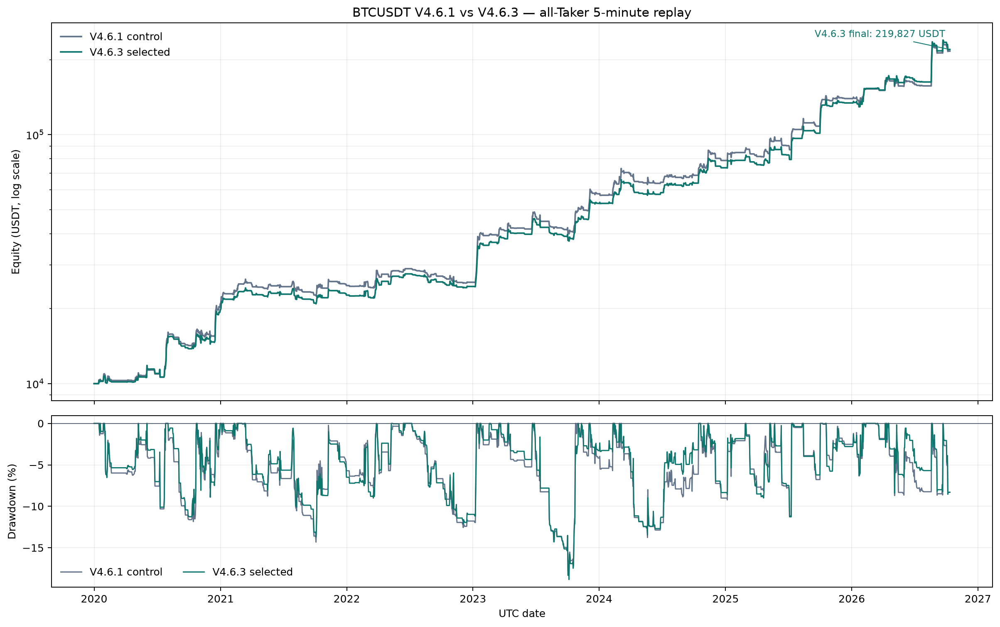
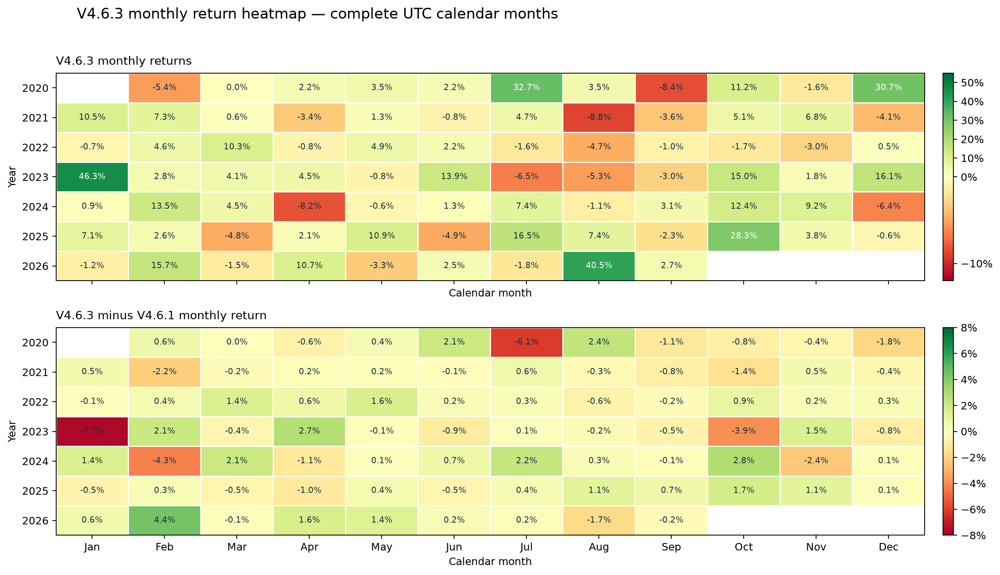

# V4.6.3 BTCUSDT 永续策略完整报告

## 结论

V4.6.3 保留 V4.6.1 的 V4.5.3/b022 多空信号，只调整月内风险预算。全样本 5 分钟 OHLC 执行回放从 2020-01-01 覆盖至 2026-10-11 07:55 UTC，主结果使用全 Taker 成交、60% 手续费返佣后的有效 Taker 费率 2.4 bps。

| 指标 | V4.6.1 控制 | V4.6.3 选择 | 变化 |
|---|---:|---:|---:|
| 累计收益 | 2064.52% | 2098.27% | 33.75% |
| 期末权益（初始 10,000 USDT） | 216,452 USDT | 219,827 USDT | +3,375 USDT |
| CAGR | 57.41% | 57.77% | 0.36% |
| 日频 Sharpe | 1.713 | 1.735 | +0.023 |
| 月均收益 | 4.38% | 4.38% | -0.01% |
| 月收益标准差 | 11.06% | 10.24% | -0.82% |
| 月度 Sharpe | 1.37 | 1.48 | +0.11 |
| 最大回撤 | -21.20% | -21.73% | -0.53% |
| 正收益月份 | 58.8% | 60.0% | +1.2% |





## 策略规则

### 信号层

- 4 小时趋势 EMA/ADX/DI 状态、小时突破/重夺、结构性空头过滤。
- 空头要求结构性下行、ADX 达标、成交活跃度确认、资金费率不过度拥挤。
- ATR、波动率和风险预算共同决定目标杠杆；目标信号每小时更新，下一小时执行。
- 参数沿用 V4.6.1：`entry=break8`、`confirmation=activity`、`ADX >= 32`、冷却 `3h`、风险档位 `higher`。

### V4.6.3 风险预算

| 条件 | 暴露系数 |
|---|---:|
| 正常月份 | `1.00` |
| 月内 BTC 收益 ≤ `-10%` | `0.50` |
| 月内 BTC 收益 ≤ `-15%` | `0.50` |
| 月内 BTC 收益 ≥ `+6%` | `0.35` |

月内收益使用完成小时收盘价计算，规则作用于下一小时，因此不读取未来价格或账户未来权益。

## 分阶段结果

| 策略 | 区间 | CAGR | 日频 Sharpe | 月均收益 | 月收益标准差 | 月度 Sharpe | 最大回撤 | 正收益月份 |
|---|---|---:|---:|---:|---:|---:|---:|---:|
| V4.6.1 control | full | 57.41% | 1.713 | 4.38% | 11.06% | 1.37 | -21.20% | 58.8% |
| V4.6.1 control | train_2020_2023 | 55.08% | 1.746 | 4.17% | 11.81% | 1.22 | -21.20% | 57.4% |
| V4.6.1 control | validation_2024_2025 | 55.30% | 1.749 | 4.03% | 8.18% | 1.71 | -14.20% | 62.5% |
| V4.6.1 control | pre_holdout_2026_01_08 | 102.47% | 1.983 | 6.89% | 15.33% | 1.56 | -11.10% | 50.0% |
| V4.6.1 control | diagnostic_2026_09_10 | -24.11% | -0.498 | 2.93% | 0.00% | 0.00 | -9.79% | 100.0% |
| V4.6.3 selected | full | 57.77% | 1.735 | 4.38% | 10.24% | 1.48 | -21.73% | 60.0% |
| V4.6.3 selected | train_2020_2023 | 51.69% | 1.728 | 3.91% | 10.50% | 1.29 | -21.73% | 57.4% |
| V4.6.3 selected | validation_2024_2025 | 59.07% | 1.812 | 4.25% | 8.24% | 1.79 | -13.80% | 66.7% |
| V4.6.3 selected | pre_holdout_2026_01_08 | 123.06% | 2.159 | 7.70% | 14.87% | 1.79 | -9.22% | 50.0% |
| V4.6.3 selected | diagnostic_2026_09_10 | -29.78% | -0.680 | 2.72% | 0.00% | 0.00 | -9.65% | 100.0% |

诊断区间为 2026-09-01 以后，仅有一个完整月，未参与候选选择。它的结果用于揭示近期敏感性，不作为样本外证明。

## 年度结果

| 策略 | 年份 | 年收益 | 日频 Sharpe | 最大回撤 |
|---|---:|---:|---:|---:|
| V4.6.1 control | 2020 | 108.59% | 2.165 | -11.84% |
| V4.6.1 control | 2021 | 17.98% | 0.972 | -14.32% |
| V4.6.1 control | 2022 | 3.12% | 0.268 | -12.57% |
| V4.6.1 control | 2023 | 126.53% | 2.803 | -18.28% |
| V4.6.1 control | 2024 | 36.17% | 1.409 | -13.77% |
| V4.6.1 control | 2025 | 77.22% | 2.043 | -11.14% |
| V4.6.1 control | 2026 | 55.09% | 1.622 | -8.71% |
| V4.6.3 selected | 2020 | 97.48% | 2.090 | -11.26% |
| V4.6.3 selected | 2021 | 14.19% | 0.827 | -13.70% |
| V4.6.3 selected | 2022 | 8.39% | 0.533 | -12.11% |
| V4.6.3 selected | 2023 | 115.60% | 2.874 | -18.83% |
| V4.6.3 selected | 2024 | 39.03% | 1.608 | -13.47% |
| V4.6.3 selected | 2025 | 82.12% | 2.010 | -11.27% |
| V4.6.3 selected | 2026 | 63.99% | 1.756 | -8.55% |

2026 年为截至 2026-10-11 07:55 UTC 的年内结果，并非完整自然年。

## 候选筛选与过拟合控制

候选集合共 8 个，在读取 2026-09 诊断窗前固定。历史选择折叠为 2020–2023、2024–2025、2026-01–2026-08。候选必须在三折中 CAGR 为正，且折叠回撤相对 V4.6.1 控制最多恶化 1 个百分点；评分使用折叠 Sharpe 中位数、Sharpe 离散度、CAGR 和月收益标准差，接近时优先简单覆盖层。

| 候选 | 稳健评分 | 2020–2023 CAGR | 2020–2023 Sharpe | 2024–2025 CAGR | 2024–2025 Sharpe | 2026-01–08 CAGR | 2026-01–08 Sharpe | 选中 |
|---|---:|---:|---:|---:|---:|---:|---:|:---:|
| control_v461 | 1.847 | 49.97% | 1.589 | 58.84% | 1.833 | 103.43% | 1.895 | 否 |
| overlay_v463 | 1.904 | 47.51% | 1.635 | 62.17% | 1.883 | 123.25% | 2.043 | 是 |
| profit_lock_050 | 1.874 | 56.37% | 1.586 | 68.66% | 1.859 | 130.18% | 1.986 | 否 |
| profit_lock_025 | 1.889 | 41.57% | 1.631 | 57.78% | 1.868 | 118.39% | 2.064 | 否 |
| cooldown6_overlay | 1.868 | 47.87% | 1.646 | 60.94% | 1.853 | 127.12% | 2.083 | 否 |
| break12_overlay | 2.001 | 44.25% | 1.552 | 66.37% | 2.009 | 142.04% | 2.224 | 否 |
| break12_cd6_overlay | 1.975 | 45.32% | 1.581 | 65.40% | 1.986 | 146.23% | 2.264 | 否 |
| risk_elevated_overlay | 1.902 | 47.00% | 1.640 | 60.64% | 1.876 | 113.48% | 1.980 | 否 |

## 执行与压力测试

执行假设：5 分钟 OHLC 成交检查、基础滑点 1 bps、冲击滑点 8 bps、单根最大参与率 2%、保护性退出使用 Taker；主结果不假设 Maker 排队优势。

| 场景 | CAGR | 日频 Sharpe | 最大回撤 | 强平次数 |
|---|---:|---:|---:|---:|
| base_all_taker | 57.77% | 1.735 | -21.73% | 0 |
| fees_plus_50pct | 54.76% | 1.672 | -22.25% | 0 |
| double_slippage | 54.07% | 1.657 | -22.37% | 0 |
| latency_1h | 49.23% | 1.560 | -22.70% | 0 |
| funding_2x | 57.67% | 1.734 | -21.73% | 0 |

## 复现与文件

```bash
python3 scripts/evaluate_v463.py --data data/bitget_20261011 --output reports/v4_6_3
python3 scripts/render_v463_report.py
```

- 权益与成交：`V4_6_1_control_equity.csv`、`V4_6_3_selected_equity.csv`、`V4_6_3_selected_trades.csv`、`V4_6_3_selected_fills.csv`
- 月收益：`monthly_returns.csv`
- 候选与压力测试：`candidate_screen.csv`、`execution_stress.csv`
- 年度结果：`annual_metrics.csv`
- 图表：`equity_curve.png`、`monthly_return_heatmap.png`

## 限制

- 历史数据在研究期间已可见，不能称为完全盲样本外验证。
- 2026-09 诊断窗口很短，不能单独用于判断长期有效性。
- Bitget 公共资金费缓存只覆盖 2026-06-27 以后，早期资金费未伪造。
- 5 分钟 OHLC 是成交代理，没有真实盘口、队列位置、盘口价差和逐笔撮合。
- 维护保证金档位沿用回测假设，实际交易所参数和资金费结算仍需前向核验。
